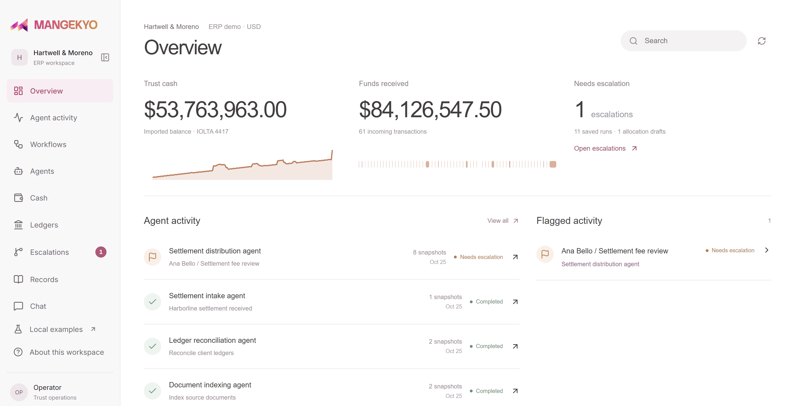
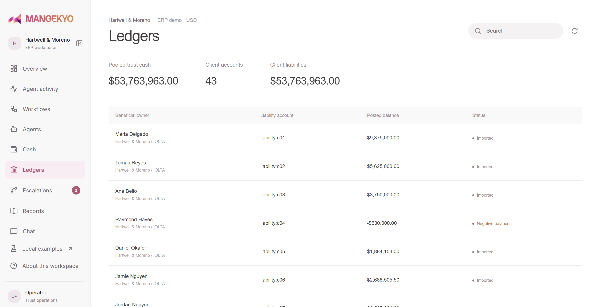
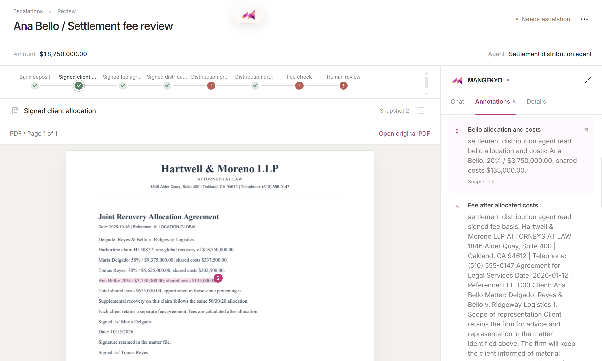
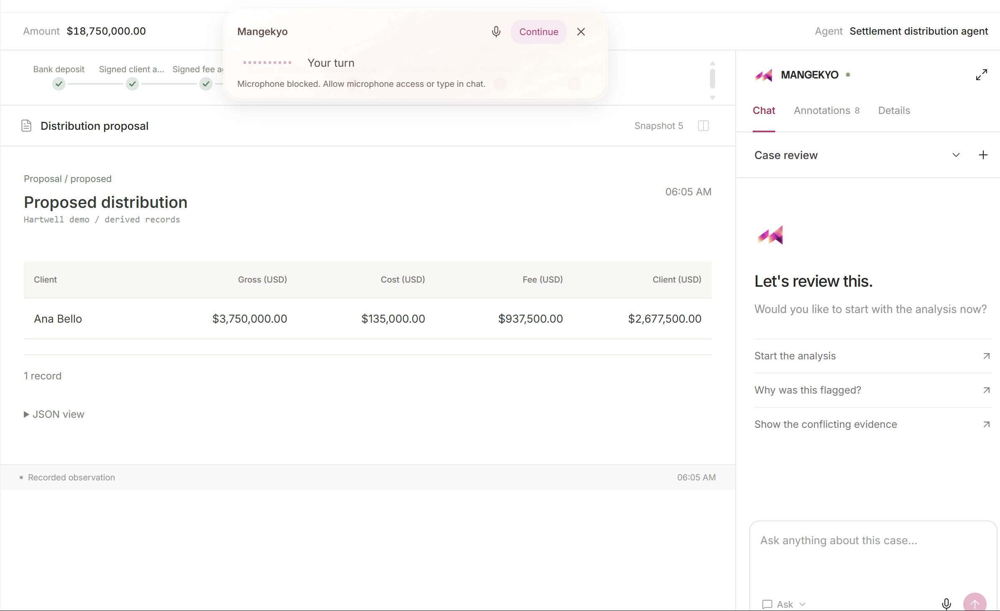

# Mangekyo: Autonomous Finance with Visual Agent Auditing

Autonomous trust-account management powered by specialized financial agents, with **Git-like version control for agent context, visual auditing, and human-in-the-loop steering**.

🏆 **5th Place, Hyphenate Autonomous Finance Track at Cal Hacks 13.0**

Built by **James and Edwin**.

## Project Demo

[](https://www.youtube.com/watch?v=BtL7Z_5xcDw)

**[Watch our full demo on YouTube]**

## Why Mangekyo?

In 2024, Synapse Financial Technologies collapsed, exposing an estimated $60–90 million shortfall in customer funds. The incident highlighted a serious problem: **knowing how much money is in an account doesn't necessarily mean knowing who owns it.**

Law firms, escrow companies, and custodial platforms manage funds belonging to thousands of clients. Tracking ownership, reconciling accounts, and verifying payments requires extensive bookkeeping and compliance review.

AI agents can automate these workflows, but introduce another problem: **how do we know what an agent actually read, interpreted, or changed?**

We built Mangekyo to solve both.

## What Mangekyo Does

Mangekyo combines an autonomous financial operations platform with an independent visual auditing agent.

### 1. Autonomous Trust Accounting

Companies connect their financial records through ERP integrations. Specialized agents process documents, reconcile accounts, verify client-fund ownership, and investigate discrepancies.

Our multi-agent system handles:

- **Document processing:** Extracting financial records, invoices, agreements, and supporting evidence.
- **Fund ownership verification:** Ensuring client funds are attributed correctly.
- **Three-way reconciliation:** Comparing bank balances, accounting records, and individual client balances.
- **Independent verification:** Cross-checking agent proposals against source documents.
- **Compliance controls:** Detecting discrepancies and blocking unsupported financial actions.

Routine operations are automated, while exceptions requiring human judgment are escalated.

### 2. Git for Agent Context

Our independent **Mangekyo agent** monitors what other agents see and do.

Using instrumented tool calls, Mangekyo records screenshots, PDF parsing, database interactions, and execution context as versioned snapshots.

These snapshots form a navigable execution graph.

When something goes wrong, human reviewers can:

- Trace the agent's execution to a specific snapshot.
- Inspect the exact documents and fields the agent accessed.
- Ask Mangekyo questions using voice or chat.
- Steer the tasked agent from the selected checkpoint.
- Create a corrected execution branch without losing the original history.
- Preserve validated corrections as reusable agent memory.

**Think Git, but for autonomous agent execution.**

## Application Overview


Our ERP workspace provides a unified view of trust-account activity, including available funds, client balances, agent tasks, and escalations.

Agents process financial records and generate tasks while Mangekyo monitors their execution.

### Trust Account Ledgers



Trust-account bookkeeping requires tracking both pooled funds and individual client ownership.

Our platform maintains client-level records and supports reconciliation across the underlying financial data.

## Visual Auditing and Human Escalation

When conflicting evidence requires human intervention, Mangekyo opens the agent's recorded execution history.



Each snapshot preserves what the tasked agent observed, the evidence it accessed, and the resulting action.

The reviewer can navigate between document snapshots, inspect highlighted evidence, and identify where the agent's decision diverged from the source records.

### Conversational Investigation



Mangekyo supports natural-language investigation through chat and voice.

Reviewers can ask questions about individual snapshots, compare documents, and request evidence-guided walkthroughs.

Once a mistake is identified, they can steer the tasked agent with corrected instructions.

The original execution remains preserved while a new branch records the corrected run.

## Our Demo: A $33,750 Trust-Account Error

Our synthetic ERP demonstrates a settlement-distribution discrepancy at **Hartwell & Moreno LLP**, a fictional law firm managing an $18.75 million settlement.

One client's signed agreement specifies a 25% attorney fee **after litigation costs**, but the proposed distribution incorrectly calculates 25% of gross recovery.

The difference is **$33,750**.

Mangekyo records the conflicting documents, escalates the discrepancy, and allows a human to trace the error through the agent's visual history.

The reviewer then corrects the agent from the relevant snapshot.

A new execution branch recalculates the fee, saves a replacement draft, and preserves the original history.

**No client funds are released during the correction.** Financial approvals remain separate.

## System Architecture

Mangekyo consists of two connected systems.

### Autonomous Finance Core

Built around specialized agents orchestrated with CREAO:

- Document intake and extraction
- Financial task orchestration
- Ownership matching
- Independent verification
- Three-way reconciliation
- Compliance checks and controlled financial actions

### Mangekyo Visual Auditing Agent

Our visual auditing layer includes:

- **Event-driven capture:** Records observations when agents interact with documents, browsers, or databases.
- **Visual snapshots:** Connects screenshots with extracted data, tool calls, and execution metadata.
- **Execution graph:** Maintains a versioned history with checkpoint relationships.
- **Evidence grounding:** Links annotations and screenshot regions to recorded sources.
- **Human steering:** Allows reviewers to issue corrections from selected checkpoints.
- **Persistent memory:** Stores approved corrections as reusable context and potential fine-tuning datasets.

The visual auditor operates separately from the financial agents. Deterministic financial controls continue to govern authorized transactions.

## Tech Stack

| Component | Technologies |
|---|---|
| Frontend | Next.js, React, TypeScript, Tailwind CSS, Radix UI |
| Backend | Convex, Node.js, SQLite |
| Agent orchestration | CREAO |
| AI models | Claude, Gemini, OpenAI |
| Visual capture | Playwright, Chromium |
| Execution visualization | React Flow |
| Conversational AI | Claude API |
| Text-to-speech | Fish Audio |
| Testing | Vitest, Playwright |
| Supporting tools | Python, pnpm, Git |

## Repository Structure

```text
mangekyo/
├── apps/
│   ├── web/                 # Main platform
│   ├── demo-erp/            # Synthetic ERP sandbox
│   ├── visual-audit-dev/    # Standalone audit workspace
│   └── finance-dev/         # Finance development workspace
│
├── packages/
│   ├── finance-core/        # Specialized financial agents
│   ├── visual-audit/        # Visual auditing and steering
│   └── contracts/           # Shared event and data contracts
│
├── convex/                  # Realtime backend and persistence
├── docs/                    # Architecture and integration guides
└── README.md
```

The structure above shows the intended monorepo organization. Refer to the repository for the current implementation.

## Quick Start

### 1. Clone the repository

```bash
git clone <YOUR_REPOSITORY_URL>
cd mangekyo
```

### 2. Install dependencies

```bash
pnpm install
```

### 3. Configure environment variables

Create the environment files required by the applications you're running.

Configure any required Convex deployment, AI provider credentials, and local ERP settings.

Never commit API credentials.

### 4. Start the development environment

```bash
pnpm dev
```

This starts the workspace's configured development command. The available application URLs and additional service commands depend on the current repository configuration.

For the standalone visual-audit application, use the setup instructions in the project's development documentation.

## What We Learned

- **Financial correctness goes beyond matching balances.** A balanced account can still contain incorrect client entitlements.
- **Agents need independent verification.** Financial decisions cannot rely solely on one model's output.
- **Visual context matters.** Screenshots and highlighted evidence make errors easier to investigate than raw logs alone.
- **Corrections should preserve history.** Agent steering should create traceable branches rather than erase mistakes.
- **Agent improvement requires validation.** Human corrections must be reviewed before becoming reusable memory or training data.

## What's Next?

We're expanding Mangekyo with:

- Additional ERP integrations
- More advanced cross-document auditing
- Persistent, approved agent memory
- Broader trust-account automation
- Benchmarks measuring financial accuracy, compliance, and recovery from errors

We also see applications for Mangekyo's visual auditing layer beyond finance, including **healthcare, insurance, legal services, cybersecurity, and other high-stakes autonomous workflows**.

Our goal is to make autonomous agents easier to understand, correct, and improve.

**Autonomy without sacrificing accountability.**
